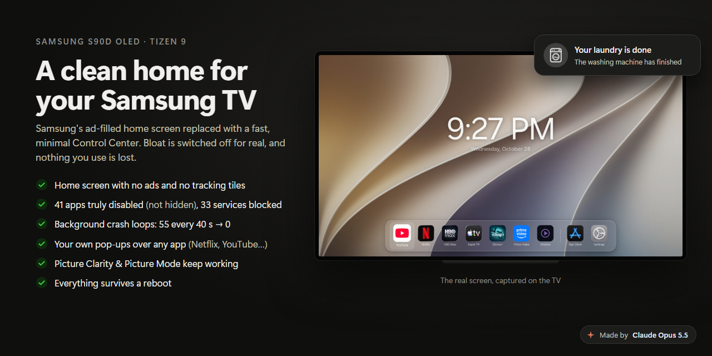
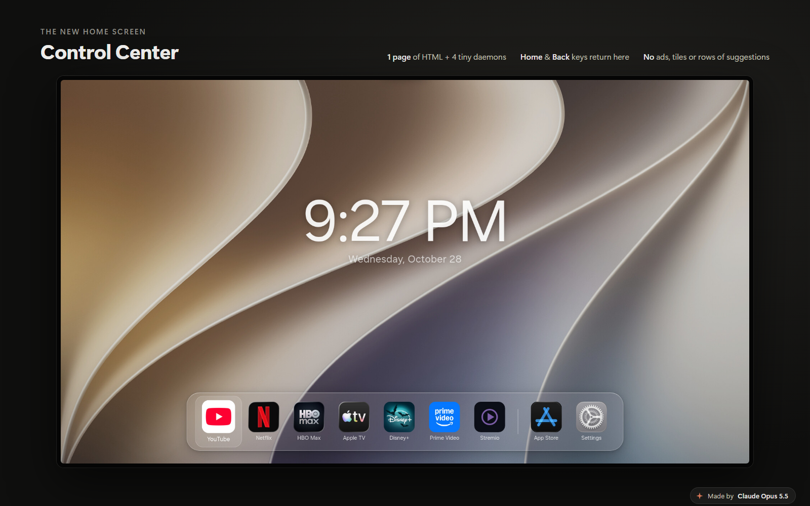
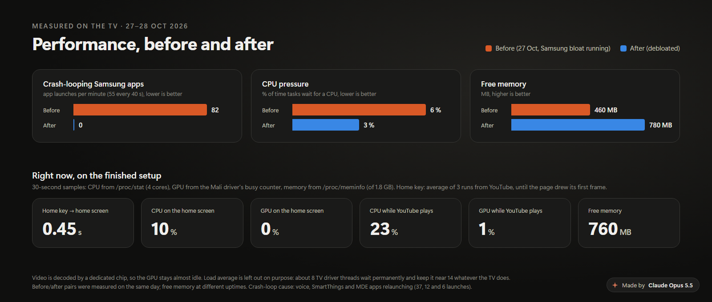

# A clean home for your Samsung TV



I replaced Samsung's home screen on my own **Samsung S90D OLED (Tizen 9, 2024)** with a small
**Control Center**. I disabled the bloat for real, not just hid it, and kept everything I use: Netflix,
YouTube, HBO Max, Apple TV, Disney+, Prime Video, AirPlay, Chromecast, picture settings and the App
Store. **All of it survives reboots**: a boot script applies the setup again every time the TV starts.

This repo is the full story, from the first privacy audit to the finished setup, with every script that
runs on the TV.

## Who this is for

| You have… | Start here |
|---|---|
| **A normal Samsung TV** (no root, the usual case) | [**No root? Do these 5 things**](#no-root-do-these-5-things). They cut most of the ads and tracking, and are easy to undo |
| **A root shell on your own TV** | [the guide](#the-guide). This repo doesn't provide a root method ([why](docs/02-root-access.md)) |
| **An AI agent (Claude, Codex…) that will do the work** | point it at [`AGENTS.md`](AGENTS.md): the rules that keep it from breaking your TV |

> Rooting and changing system files can void your warranty and is at your own risk. Every change here
> can be undone ([Recovery](docs/09-recovery.md)).

## No root? Do these 5 things

1. **Settings → General & Privacy → Terms & Privacy** (on some 2025 models: Settings → Support →
   Terms & Privacy): turn off **Viewing Information Services** (that's ACR), **Interest-Based
   Advertisement** (then **Reset Advertising ID**) and **Voice Recognition Services**.
2. **Settings → General & Privacy → Start Screen Option** (or *Smart Features*): turn off **Start with
   Smart Hub Home**, **Autorun Smart Hub**, **Autorun Last App** and **Autorun Samsung TV Plus**. This
   stops TV Plus from starting by itself.
3. **Block at your router, not with a giant list.** Point the TV at a filtering DNS (AdGuard DNS,
   NextDNS, Pi-hole), watch its DNS log for a day, and block what it actually contacts. Big public
   Samsung lists are known to break the app store and TV Plus ([chapter 1](docs/01-privacy-research.md)).
   Also block the TV's hard-coded fallback to 8.8.8.8.
4. **Ad-free YouTube:** [TizenBrew](https://github.com/reisxd/TizenBrew) with the TizenTube module
   (Developer Mode, no root).
5. **Updates:** turn off **Auto Update** and choose **Do not update** in the pop-up, if you prefer to
   keep the firmware you have. Weigh this against missing security fixes.

## What you get with root

| | Before | After |
|---|---|---|
| Home screen | Samsung Home: ads, "recommended" rows, TV Plus | Control Center: clock, date, your apps, nothing else. Back on screen ~0.45 s after pressing Home |
| Preinstalled bloat | can't be uninstalled, keeps running in the background | **41 apps disabled** in the package manager, **33 services blocked**, still the case after a reboot |
| Crash loops | 55 background app launches every 40 s | **0** |
| Tracking | ACR, telemetry, ad ID, voice backend | blocked on the TV *and* at the router |
| Picture settings | Picture Clarity / Picture Mode greyed out once Samsung Home is gone | working ([the cause](docs/06-picture-clarity.md)) |
| Notifications | none from your own services | pop-ups **over any app**: orders, laundry, dishwasher, anything |

We don't claim the TV is "x times faster". We measured what we could measure, and it's in
[Performance](docs/07-performance.md).



## The guide

1. [Privacy research](docs/01-privacy-research.md): what the TV talks to, and blocking it at the router
2. [Root access](docs/02-root-access.md): what you need, and how Tizen 9 behaves (SMACK, UEP, cynara)
3. [Debloat](docs/03-debloat.md): **disable** apps instead of hiding them, block services, avoid restart loops
4. [Control Center](docs/04-control-center.md): a web app as the home screen, launching apps, remote keys
5. [Notifications over any app](docs/05-notifications.md): native Samsung pop-ups without libnotification
6. [Picture settings greyed out](docs/06-picture-clarity.md): the usual causes, and the one that hits custom home screens ([short fix for any launcher](docs/picture-fix-any-launcher.md))
7. [Performance](docs/07-performance.md): what was measured, and how to measure your own TV
8. [Lessons and dead ends](docs/08-lessons.md): what didn't work, and mistakes worth avoiding
9. [Recovery](docs/09-recovery.md): undo any part, or all of it
10. [Compatibility](docs/10-compatibility.md): check your model before changing anything, and report results
11. [Timeline](docs/timeline.md): from the first DNS log to the finished setup




## How this differs from Quiet Tizen

[Quiet Tizen](https://github.com/jss8649/quiet-tizen) is a well-documented project with the same goal,
built on a 2025 U8000F. If you use your TV mainly as an HDMI display, look at it first. The approaches
differ:

| | Quiet Tizen | This repo |
|---|---|---|
| Root | taken again from a PC for each maintenance session | needed to install or change things, not to keep them working: the boot script re-applies everything at every start |
| Survives a reboot | launcher yes. Only some cleanup changes | everything: disabled apps, blocked services, masked loops, home app, daemons |
| Launcher | native .NET/NUI (needs Samsung's private assemblies to build) | one HTML page in the TV's web runtime, nothing to build |
| HDMI inputs, quick settings, game controller | yes | not yet |
| Pop-ups over any app | not covered in its docs | yes |
| Picture settings fix for custom home screens | not covered in its docs | yes |
| Per-model profiles, recovery SQL | yes | [compatibility check](docs/10-compatibility.md) + [recovery](docs/09-recovery.md) |

## FAQ

**Will this work on my TV?** It was built and verified on one S90D (EU, Tizen 9, May 2026 firmware).
Other 2024–2025 Tizen 9 models are likely close, but app IDs and service names vary by model and
region. Run the read-only [compatibility check](docs/10-compatibility.md) first, and please report the
result.

**Can I uninstall Samsung's preinstalled apps?** Not on retail firmware. With root you can **disable**
them in the package manager, which is stronger than hiding: they can't start or run in the background,
and that survives reboots ([Debloat](docs/03-debloat.md)).

**Will my TV be faster?** Fewer things run, so there's more free memory and no crash loops (55 launches
every 40 s down to 0). Menus are only as fast as the TV's chip. We give measurements, not a speed-up
factor.

**My Picture Clarity is greyed out, and I haven't rooted anything.** It's usually the input type (an HDMI
source set as **PC**), **Game Mode** or **Input Signal Plus**. See
[chapter 6](docs/06-picture-clarity.md).

**Picture modes greyed out since I installed another launcher (Arn0-Launcher or similar).** Same bug we
hit: a flag Samsung Home leaves set. One D-Bus call fixes it, with any launcher:
[the standalone fix](docs/picture-fix-any-launcher.md).

**Does blocking updates make the TV less safe?** Yes, you stop getting Samsung's security fixes. The
setup blocks auto-update because an update can remove root and parts of the system it relies on. It's a
trade-off, explained in [chapter 2](docs/02-root-access.md#firmware-updates).

**Is a static home screen bad for an OLED?** The Control Center is mostly a still image, so we kept
Samsung's screensaver and burn-in protection (see [Control Center](docs/04-control-center.md#oled-care)).

**Can an AI agent do this for me?** That's how this was built: the owner plus Claude Opus 5.5 over a root
shell. Give your agent [`AGENTS.md`](AGENTS.md). It lists the mistakes that cost us hours.

**What about ads inside apps?** Those come from the apps themselves (YouTube, TV Plus…). This setup
removes Samsung's own ads and home-screen promotions. For YouTube, see TizenTube above.

## Repo layout

```
tv/control-center/   the home screen web app (index.html, config.xml, icons). Add your own wallpaper.jpg
                     (1920x1080) and, optionally, a noti.wav sound
tv/opt-etc/          everything that runs on the TV from /opt/etc
  parseinfo.sh         boot script: blocks services, masks restart loops, registers and starts the CC
  cc-launcher.awk      launches apps the CC asks for; keeps picture settings available; optional feeds
  cc-keymon.awk        remote keys: Home/Back -> CC, Power -> standby, extra button -> an app
  cc-backmon.awk       returns to the CC when you exit a streaming app
  cc-notifywake.awk    native pop-ups over any app
  cc-perf.awk          CPU / GPU / memory sampler
  cc-launchtime.awk    times how fast an app (or the CC) comes on screen
  cc-disabled-apps.txt the 41 disabled app IDs
  smack-cc.rules       SMACK rules for the CC app label
tv/register/         package database rows that register the CC app
tools/               PC helpers: tvcmd.sh, push.sh / pull.sh, inventory.sh (read-only model check)
art/                 HTML sources of the images in screenshots/
AGENTS.md            rules for AI agents working on a TV
```

## Not affiliated

Samsung, Tizen, Netflix, YouTube, HBO Max, Apple TV, Disney+, Prime Video and Stremio are trademarks of
their owners. The streaming-app logos in the dock belong to those services; replace them if you
redistribute the page. The App Store and Settings icons in this repo are original artwork. The
screenshots show the owner's own TV, with a personal wallpaper and icon choice that isn't part of the repo.

## Credits

Built by the TV's owner together with **Claude Opus 5.5** (Anthropic), working over a root shell:
reverse engineering, scripts, the Control Center and this write-up. Thanks to
[Quiet Tizen](https://github.com/jss8649/quiet-tizen), [TizenBrew](https://github.com/reisxd/TizenBrew)
and [Calif's research on Samsung TV root access](https://calif.io/research/samsung).

<sub>Made by Claude Opus 5.5</sub>
