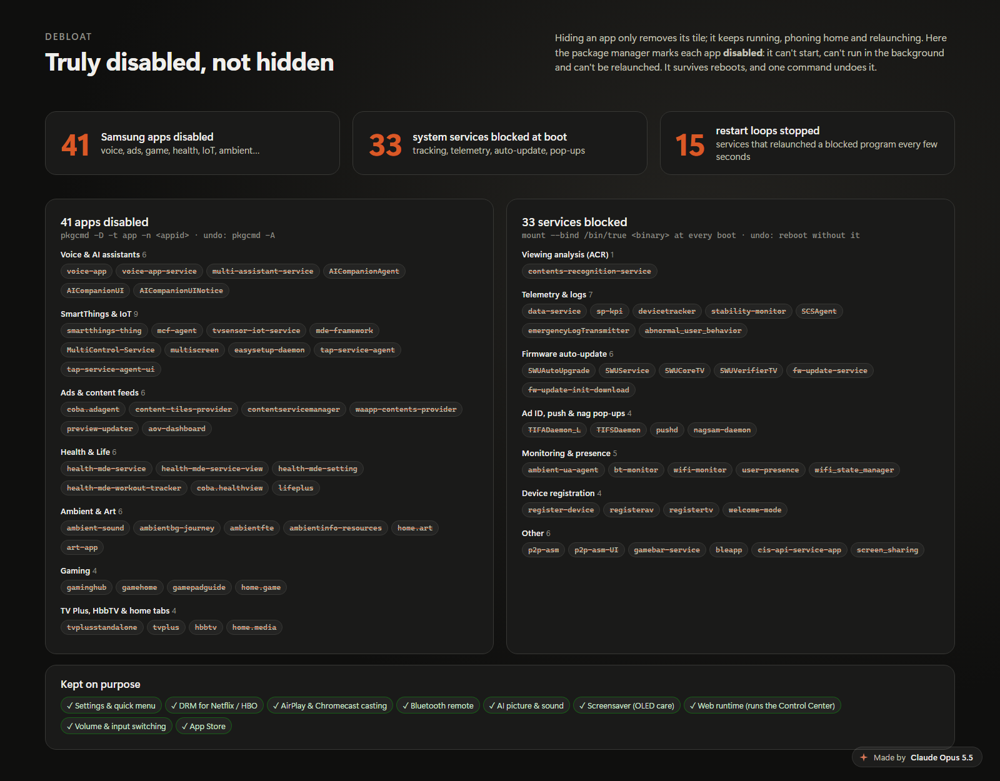

# 3. Debloat: disabled, not hidden



Hiding an app removes its tile. It keeps its background services, keeps phoning home, and the system
keeps relaunching it when it crashes. There are three tools, each for a different kind of component.

## 1. Apps: disable them in the package manager

```sh
pkgcmd -D -t app -n <appid>        # disable (no --global: with it the call fails, "Failed to get appinfo")
pkgcmd -A -t app -n <appid>        # enable again
sqlite3 /opt/dbspace/.pkgmgr_parser.db "select app_id from package_app_info where app_disable='true'"
```

A disabled app is refused by the launcher (`not available for the user`), can't run in the background,
and stays disabled across reboots, because the flag lives in the package database. Our 41 app IDs are in
[`cc-disabled-apps.txt`](../tv/opt-etc/cc-disabled-apps.txt):

| Group | Apps | Why |
|---|---|---|
| Voice & AI assistants | voice-app, voice-app-service, multi-assistant-service, AICompanion (3) | not used. voice-app alone relaunched 37 times in 40 s |
| SmartThings & IoT | smartthings-thing, mcf-agent, tvsensor-iot-service, mde-framework, MultiControl-Service, multiscreen, easysetup-daemon, tap-service-agent (+ui) | device registration and discovery traffic, crash loops |
| Ads & content feeds | coba.adagent, content-tiles-provider, contentservicemanager, waapp-contents-provider, preview-updater, aov-dashboard | the home screen's ads and "recommended" rows |
| Health & Life | health-mde-* (4), coba.healthview, lifeplus | not used |
| Ambient & Art | ambient-* (4), home.art, art-app | not used |
| Gaming | gaminghub, gamehome, gamepadguide, home.game | not used |
| TV Plus, HbbTV, home tabs | tvplusstandalone, tvplus, hbbtv, home.media | ad-funded channels, broadcaster overlays, Samsung Home tabs |

## 2. System programs: bind-mount `/bin/true` over them at boot

`/usr` is read-only, and many services are plain binaries started by systemd. The boot script mounts
`/bin/true` over each one, so the service starts, exits successfully at once and does nothing:

```sh
test -f /usr/bin/<name> && mount --bind /bin/true /usr/bin/<name>
```

The 33 programs we block: ACR (`contents-recognition-service`); telemetry and logs (`data-service`,
`sp-kpi`, `devicetracker`, `stability-monitor`, `SCSAgent`, `emergencyLogTransmitter`,
`abnormal_user_behavior`); firmware auto-update (`SWU*`, `fw-update-*`); the advertising ID, push and nag
pop-ups (`TIFADaemon_L`, `TIFSDaemon`, `pushd`, `nagsam-daemon`); monitoring and presence
(`ambient-ua-agent`, `bt-monitor`, `wifi-monitor`, `user-presence`, `wifi_state_manager`); device
registration (`register-device`, `registerav`, `registertv`, `welcome-mode`); and a few others (`p2p-asm`,
`gamebar-service`, `bleapp`, `cis-api-service-app`, `screen_sharing`). See
[`parseinfo.sh`](../tv/opt-etc/parseinfo.sh).

Programs that were already running before the mounts are killed by path a few seconds later. Use
`kill -9`: `stability-monitor` ignores SIGTERM.

## 3. Restart loops: mask the units for this boot

**This is the trap.** A unit with `Restart=always` whose program is now `/bin/true`, or whose app is now
disabled, gets restarted every 2–5 s **forever**. We saw up to 130 restarts in a few minutes, a real
load source. The fix runs at every boot:

```sh
systemctl mask --runtime <unit>.service; systemctl stop <unit>.service
```

`--runtime` puts the mask in `/run`, which works with a read-only `/etc` and is re-applied at each boot.
**After every new block or disable, look for loops:**

```sh
systemctl list-units --all --no-legend --plain | grep ' activating '
```

Our 15 units are listed in `loop_units` in the boot script.

## Keep these

| Keep | Why |
|---|---|
| `org.tizen.menu`, `home.sidebar`, quicklaunch | Settings and the gear menu |
| `coba.setting*`, `settings-datafw`, `avocd` | the settings back end and picture/sound control |
| web runtime (`wrt`, webappservice, litewebappservice, webserver) | the Control Center is a web app |
| DRM (`dseal`, `Ddrm`) | Netflix, HBO Max and other DRM video |
| Bluetooth apps | the remote |
| AI picture/sound services | picture processing (blocking them didn't help anything) |
| casting (`airplay-app-2`, `googlecast-app`, `dmr_service_app`) | AirPlay and Chromecast |
| screensavers (`spotlight-ss`, `glscreensaver-launcher`) | OLED burn-in protection with a static home screen |
| volume, input switching, App Store | everyday use |

## Safety check after every change

```sh
dbus-send --system --print-reply --dest=org.tizen.tv.avoc /org/tizen/tv/avoc \
  org.tizen.tv.avoc.AvOutputControl.CheckAutoMotionPlus     # expect int32 1
systemctl list-units --all --no-legend --plain | grep -c ' activating '   # expect 0
```

Also check that Settings opens, a streaming app plays, and the Control Center daemons are active.
