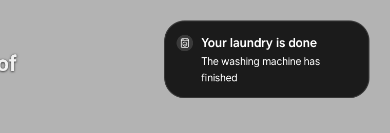
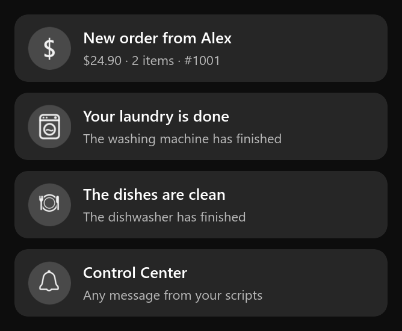

# 5. Notifications over any app

Goal: when something happens (a new web-shop order, the washing machine or dishwasher finishes, or any
custom message), show a pop-up **instantly, over whatever is playing** (Netflix, YouTube, live TV…),
without leaving the app.





## Why this is hard on Tizen 9

| Attempt | Result |
|---|---|
| Show the Control Center (CC) banner while another app is on screen | Impossible: the CC is a web app, and its window is behind the app on screen. |
| `tizen.notification.post()` from the CC page | **Not available**: the TV's web runtime ships without `libtizen_notification.so`. `tizen.notification` is `undefined`. |
| Keep the page's JavaScript running in the background (`background-support`, `background.execution.support`, `disable.bgtimer.throttle`, `suspend.delay`…) | Samsung's web runtime suspends a hidden web app immediately. None of these metadata keys help. |
| Native helper binary (C, cross-compiled) | Blocked: **UEP** (Unsigned Executable Protection) refuses unsigned ELF files everywhere, including `/tmp`, and also when loaded through `ld.so`. |
| Shell script helper | UEP also blocks unsigned **shell scripts** run as `sh script.sh`. Inline `sh -c '…'` and `awk -f` scripts are allowed. |
| Samsung's notification service app (`NotiEvent`, `ocf_noti` app-control keys) | Disabled in retail firmware ("skipped!"). |

## What works

```
cc-launcher.awk  ─ polls the order / appliance feeds every 60 s ─▶ cc_orders.json, cc_appliances.json
                                                                       │
cc-notifywake.awk (every 2 s) ── data changed & CC not on screen ──▶ launch_app ClaudeTVCC0.ControlCenter __K_BG_LAUNCH enable
                                                                       │   (resumes the page's JS for ~1 min, window stays hidden)
CC page (index.html) ── detects the event ── CC on screen? ── yes ──▶ its own banner (top of the home screen)
                                               │ no
                                               ▼
                                     appends "title|message|icon" to cc_native
                                               │
cc-notifywake.awk ── builds a Tizen notification and posts it over D-Bus ──▶ data-provider-master (add_noti)
                  └─ launch_app com.samsung.tv.notification-app NOTIFICATION_PRIVATE_ID <id>  ──▶ Samsung pop-up over any app
```

### 1. Waking the page
`launch_app <appid> __K_BG_LAUNCH enable` resumes a suspended web app for about a minute **without
raising its window**. The app on screen stays. A page woken this way still reports
`document.hidden = false`, so the daemon also writes the app on screen to a data file (`cc_fg`). The
page reads that file to decide whether it is really in the background.

### 2. Posting a native notification without libnotification
`libnotification` talks to `data-provider-master` over D-Bus. We call the same method directly with `gdbus`:

```sh
sh -c 'echo User::Pkg::ClaudeTVCC0 > /proc/self/attr/current && exec gdbus call --system \
  --dest org.tizen.data_provider_service --object-path /org/tizen/data_provider_service \
  --method org.tizen.data_provider_noti_service.add_noti "<{1: <0>, 2: <1>, …}>"'
```

* The D-Bus policy checks the `http://tizen.org/privilege/notification` privilege through **cynara**,
  using the sender's SMACK label. Root's label (`User`) is denied, so the call switches its own label to
  the CC app's label first. The privilege is granted to that label at every boot:
  `cyad -s -k MANIFESTS_GLOBAL -c User::Pkg::ClaudeTVCC0 -u '*' -p http://tizen.org/privilege/notification -t 65535`
* The argument is a GVariant `a{iv}` dictionary. The keys that matter are:

  | key | meaning | value used |
  |---|---|---|
  | 1 / 2 | type / layout | 0 / 1 |
  | 6 / 7 | package / caller app id | `ClaudeTVCC0` / `ClaudeTVCC0.ControlCenter` |
  | 30 | text bundle: `"0"` title, `"1"` content | base64 bundle |
  | 34 | image bundle: `"0"` icon path | base64 bundle |
  | 46 / 47 | time | `systime()` |
  | 49 | display_applist | 17 |
  | 53 | app label | `Control Center` |
  | 63 / 64 | hide timeout / delete timeout (s) | 8 / 600 |
  | 67 | auto remove | 1 |
  | 71 | uid | 5001 (owner) |

* **Bundle encoding** (Tizen `bundle_encode`): `base64( md5hex(raw) + raw )`. For each key/value pair,
  `raw` is: `u32 size, u32 type 0x0401 (string), u32 key length, key\0, u32 value length, value\0`, all
  little-endian. The daemon builds it byte by byte in awk (run it with `LC_ALL=C` so `length()` counts
  bytes).
* The reply is `(id,)`. A raw D-Bus post does **not** start the viewer (libnotification normally does),
  so the daemon launches Samsung's default viewer (from `/usr/share/notification/notification.ini`) itself:
  `launch_app com.samsung.tv.notification-app NOTIFICATION_PRIVATE_ID <id>`.

### 3. The look
Samsung draws a dark rounded card at the top right: icon (key 34 `"0"`), bold title, message.
* The icon must be readable by the viewer: put it in a directory labelled `_` (`chsmack -a _`), not under
  `zone/template/securedata`.
* Don't send Samsung's 9-patch background as the sub-icon (key 34 `"5"`). It is drawn as an empty box.
* Buttons come only from Samsung's own "ActiveStyle" templates.

Our icons are 96×96 white glyphs on a 16 % white circle (`tv/control-center/cc-*.png`). The home-screen
banner uses the same PNGs, so both views look the same.

## Test it
Append a line to `cc_native` (title|message|icon, where icon is order, washer, dishwasher or bell):

```sh
tools/tvcmd.sh 'echo "Hello|This is a test|bell" >> /home/owner/apps_rw/xwalk-service/data/cc_native'
```

Within about 2 s the pop-up appears over whatever is on screen. Any root process can also send a message
through the page with `cc_push` ("title|message" lines).

Latency: ~4 s from data change to pop-up. In our setup, order arrival is bound by the 60 s feed poll.
